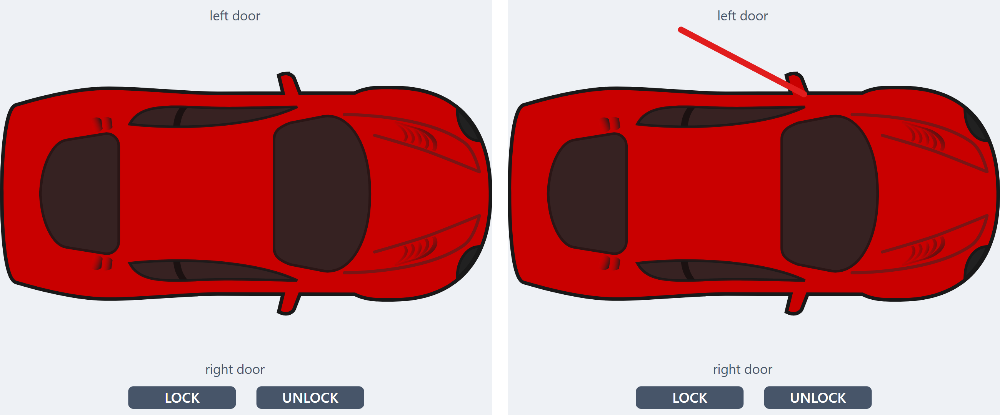
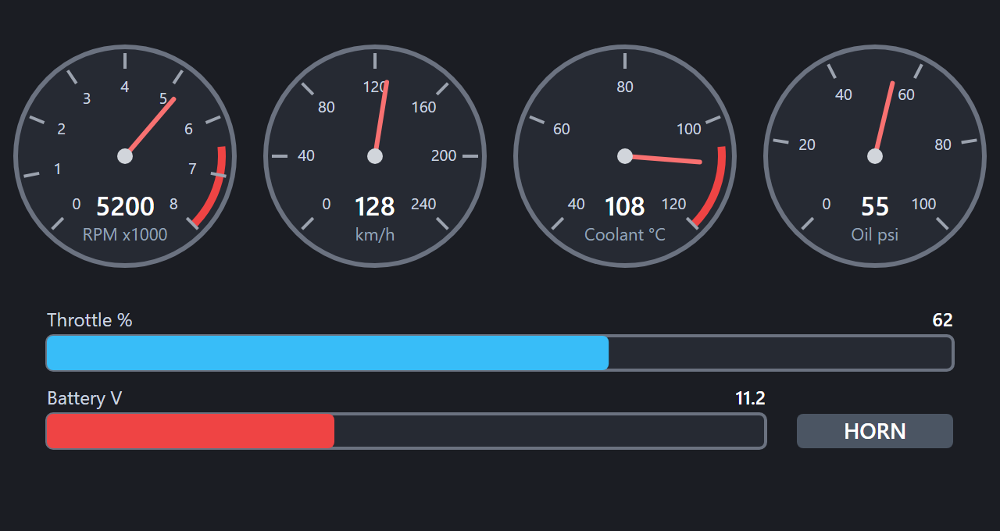

# Graphical Panel Controls: SVG Graphic

An SVG Graphic control shows a drawing you made in a vector graphics program such as Inkscape. The drawing can react to signal values and can set signals. You can build gauges, bars, indicator lights, buttons or a picture of a vehicle that changes as the vehicle runs.

Vehicle Spy does not draw the graphic itself. The drawing, and any animation it has, comes from the SVG file. Vehicle Spy only connects the names in the SVG file to signals.

## How an SVG Is Connected to Signals

The SVG file declares the **names** it reads and the names it writes. You choose the **signal** for each name in the property grid.

* A name the SVG reads is an **input**. Vehicle Spy sends the value of the signal to the SVG.
* A name the SVG writes is an **output**. When the SVG sets it, Vehicle Spy sets the signal.

The names have no meaning to Vehicle Spy. `rpm` is only a label the author of the SVG chose. You can connect `rpm` to any signal, for example a temperature. The graphic does not know what the number means, so a gauge drawn with a scale of 0 to 8000 still shows 0 to 8000.

When you load an SVG file, Vehicle Spy finds the names in it and adds one row to the property grid for each name:

* `In: rpm` is an input called `rpm`.
* `Out: horn` is an output called `horn`.

Double-click a row to choose its signal or expression, the same way you do for other graphical panel controls.

## Add an SVG Graphic to a Panel

1. Add an **SVG Graphic** control to the panel the same way you add any other tool. See [Add or Delete a Tool](../graphical-panels-add-or-delete-a-tool.md).
2. Select the control. Double-click the **SVG File** row, and choose an `.svg` file.
3. Double-click each **In:** row and choose the signal or expression to show.
4. Double-click each **Out:** row and choose the signal to set.
5. Start the measurement. The graphic appears.

**Table 1: SVG Graphic Control Properties**

| Property | Function and Options |
| -------- | -------------------- |
| SVG File | Double-click to choose the SVG file. Shows the file name once a file is loaded. The file is stored inside the setup, so the setup does not need the file afterward. |
| In: _name_ | One row for each input in the SVG. Double-click to choose the signal or expression whose value is sent to the SVG. If the signal is a text signal, or **Evaluate as text** is checked for it, the SVG receives text. Otherwise it receives a number, or `null` when the value is not a valid number. |
| Out: _name_ | One row for each output in the SVG. Double-click to choose the signal that is set when the SVG sets this output. Until you choose a signal, the output does nothing. |

A list of common properties for all controls can be found under [Common Control Properties](graphical-panel-controls-common-control-properties.md). The **Transparent** and **BackColor** properties set the color behind the drawing. A transparent control uses the color of the panel, so controls behind the graphic do not show through.

The SVG Graphic control also works on a [floating panel](../floating-panels.md).

## When the Graphic Is Shown

Vehicle Spy runs the graphic, with its script and signal values, only while the measurement is running. When it is not running, the control shows a picture of the SVG as it looks before any value arrives, for example a gauge with its needle at its starting position. You can select, move and resize the control as usual.

Vehicle Spy takes the picture again when you load another SVG, change the color behind the drawing, or finish resizing the control. While you resize, the old picture keeps its shape and the new one appears a moment after you let go.

The graphic is drawn with the Microsoft Edge WebView2 runtime. Until the first picture is ready, and if a picture cannot be taken, the control shows a box with the words **SVG Graphic** and the name of the file instead. A picture cannot be taken when the runtime is not available on the computer, or when the SVG is larger than about 2 MB.

## Prepare the SVG

You can draw in any vector graphics program. Then you add attributes that name the inputs and outputs. In Inkscape, use **Edit > XML Editor** (Ctrl+Shift+X): select an object, and add an attribute with the **+** button.

**Table 2: Attributes Vehicle Spy Looks For**

| Attribute | Put it on | What it does |
| --------- | --------- | ------------ |
| `data-vspy-in="name"` | Any element | Declares the input `name`. When the value changes, Vehicle Spy writes it into the element if the element is a `text` or `tspan`. Every element with the attribute also gets the current value in a `data-vspy-value` attribute. A script or a style sheet can use it. |
| `data-vspy-out="name"` | Any element | Declares the output `name`. Clicking the element sets the output to 1. |
| `data-vspy-click="value"` | An element with `data-vspy-out` | The value to set when the element is clicked instead of 1. |

A name can contain letters, digits, underscores, hyphens and periods. Vehicle Spy ignores a name with any other character, such as a space. Names are case-sensitive. A name that is declared several times appears once in the property grid. Inputs and outputs are listed separately, so the same name can be an input and an output.

In Inkscape, a text object contains a `tspan` element. Add `data-vspy-in` to the `tspan` so the text keeps its formatting.

Vehicle Spy finds the names by reading the text of the file. Every name has to be written in the file, and a name inside an XML comment counts too. A script cannot invent a name while it runs.

Vehicle Spy scales the drawing evenly to fit the control and centers it, so a control with another shape than the drawing shows empty bands at its sides or its top and bottom. The SVG needs a `viewBox` attribute for this. Inkscape always writes one. Without it, the drawing keeps its own size and is not scaled.

## Animate the Drawing With a Script

An attribute can show a number in a text object, but cannot move or color a shape. To do that, put a script in the SVG. Vehicle Spy runs it in the browser that draws the graphic.

The script receives values and sends values like this:

* **When values arrive**, the page gets an event named `vspy` on `document`. `event.detail` holds only the inputs that changed, for example `{rpm: 5200}`. When the graphic is first shown, it holds all inputs that have a value.
* `vspy.values` holds the latest value of every input received so far.
* `vspy.set("name", value)` sets the output `name`. This needs the attribute `data-vspy-out="name"` on some element, so that the output exists. Any element works, including a `desc` element that is only there to declare the name.

`vspy` exists only after your script has first run, so call `vspy.set` and read `vspy.values` inside an event or click handler, never at the top level of the script.

A click sets the output once and never sets it back, so the `horn` output in the example stays at 1. For a momentary button, call `vspy.set("horn", 1)` when the pointer goes down and `vspy.set("horn", 0)` when it goes up, from `pointerdown` and `pointerup` handlers.

Put the script in a CDATA section, so the file stays valid XML and programs such as Inkscape can open it.

This example shows the input `rpm` as a number, grows a bar with it, and sets the output `horn` when the button is clicked:

```xml
<svg xmlns="http://www.w3.org/2000/svg" viewBox="0 0 200 120">
  <text data-vspy-in="rpm" x="100" y="40" text-anchor="middle" font-size="24">0</text>
  <rect id="bar" x="10" y="60" width="0" height="20" fill="steelblue"/>
  <g data-vspy-out="horn" data-vspy-click="1" style="cursor:pointer">
    <rect x="70" y="90" width="60" height="24" rx="4" fill="#446"/>
    <text x="100" y="107" fill="#fff" text-anchor="middle" font-size="14"
          pointer-events="none">HORN</text>
  </g>
  <script><![CDATA[
    document.addEventListener('vspy', function (e) {
      if ('rpm' in e.detail)
        document.getElementById('bar').setAttribute('width',
          180 * Math.min(e.detail.rpm, 8000) / 8000);
    });
  ]]></script>
</svg>
```

Loading it adds the rows **In: rpm** and **Out: horn**.

To build a different gauge, change the scale in the script, not in Vehicle Spy. To add a second input, declare a second name in the file and read it in the same event.

## Examples

Two example SVG files show the two ways to animate a drawing. The car uses only a style sheet. The dashboard uses a script. To try one, add an SVG Graphic to a panel, choose the file with **SVG File**, and connect the **In:** and **Out:** rows to signals as described under each example.

### Example: A Car With Doors

Download [car.svg](../../../../.gitbook/assets/svg-graphic-car.svg).

The file shows a two-door car seen from above, with its front to the right. Each door is an input. When the value of an input is 1, a red line appears at that door, as if the door were open. When the value is 0, the line goes away.



**Table 3: Names in car.svg**

| Name | Kind | Meaning |
| ---- | ---- | ------- |
| door_left | Input | The left door, the top of the picture. 0 is closed and 1 is open. |
| door_right | Input | The right door, the bottom of the picture. 0 is closed and 1 is open. |
| lock | Output | The LOCK and UNLOCK buttons. A click on LOCK sets the output to 1. A click on UNLOCK sets it to 0. |

**This file has no script.** Vehicle Spy writes the value of an input into the `data-vspy-value` attribute of the element that declares it. The style sheet at the top of the file shows the red line when that value is 1:

```css
.door-open { opacity: 0; }
.door-open[data-vspy-value="1"] { opacity: 1; }
```

Each door is a group that holds its line, drawn from the door's hinge outward:

```xml
<g class="door-open" data-vspy-in="door_left"><line x1="578" y1="44" x2="338" y2="-82"/></g>
```

To try it:

1. Add an SVG Graphic and choose `car.svg`. The rows **In: door_left**, **In: door_right** and **Out: lock** appear.
2. Double-click each **In:** row and choose a signal that is 0 when the door is closed and 1 when it is open. For a test without a vehicle, create an Application Signal for each door and change its value. A signal that is not 0 or 1 does not match the rule: use an expression that gives 0 or 1. The rule also does not match when **Evaluate as text** is checked for the row, because the SVG then receives the formatted text.
3. Start the measurement and change a signal. The red line appears and goes away.
4. Double-click **Out: lock** and choose the signal that the buttons set. A click on LOCK sets it to 1 and a click on UNLOCK sets it to 0. Both buttons use the same output: the value they set is in their `data-vspy-click` attribute.

Each button is a group like this one:

```xml
<g class="btn" data-vspy-out="lock" data-vspy-click="0"> ... UNLOCK ... </g>
```

To use another car, replace the drawing and keep the two door groups. Move their lines to the doors of the new drawing. For a car with four doors, copy a group, change its `data-vspy-in` name and its line, and choose the file again.

The car drawing is "Red Car (top-down)" by sheikh_tuhin, released as CC0 (public domain) on [OpenGameArt](https://opengameart.org/content/red-car-top-down).

### Example: A Dashboard

Download [dashboard.svg](../../../../.gitbook/assets/svg-graphic-dashboard.svg).

The file draws four gauges and two bar graphs. A script in the file draws the needles and fills the bars, because an attribute alone cannot move a needle.



**Table 4: Names in dashboard.svg**

| Name | Kind | Meaning |
| ---- | ---- | ------- |
| rpm | Input | Engine speed gauge, 0 to 8000 (the dial is marked in thousands), red above 6500. |
| speed | Input | Vehicle speed gauge, 0 to 240. |
| coolant | Input | Coolant temperature gauge, 40 to 120, red above 105. |
| oil | Input | Oil pressure gauge, 0 to 100. |
| throttle | Input | Throttle bar, 0 to 100 percent. |
| battery | Input | Battery voltage bar, 8 to 16 volts. It turns red below 11.5. |
| setthrottle | Output | A click on the throttle bar sets this output to the percentage under the pointer. |
| horn | Output | The HORN button. A click sets the output to 1. |

Each gauge is one line near the top of the file. Its scale is in the `data-min`, `data-max` and `data-step` attributes next to its input name. To add a gauge, copy one of those lines, change its name, its scale and its position, and choose the file again. Each bar is a short group that holds its track, its fill and two texts: copy the whole group to add a bar. A bar has `data-min` and `data-max` too, and `data-low` turns it red below that value.

To try it:

1. Add an SVG Graphic and choose `dashboard.svg`. The six **In:** rows and two **Out:** rows appear.
2. Choose a signal for each row. For a test without a vehicle, create an Application Signal for each input.
3. Start the measurement and change the signals. The needles move and the bars fill.
4. Choose a signal for **Out: setthrottle** and click the throttle bar. The signal is set to the percentage you clicked.

## Things to Know

* **The setup keeps its own copy.** If you change the SVG file afterward, double-click **SVG File** and choose it again. Inputs and outputs whose names are still in the file keep their signals. A name that you rename or remove loses its signal, and a new name starts with none. The setup remembers only the name of the file, not its folder, so you browse to the file each time. **Undo** brings back the previous SVG.
* **Outputs set signals only while the measurement is running.**
* **The page has no network access.** Links, external images, external fonts and external scripts do not load. Put images inside the SVG as `data:` addresses. Fonts cannot be embedded: the SVG can only use fonts that are installed on the computer. A link in the SVG goes nowhere, and a script cannot open a new window.
* **Size.** An SVG file larger than about 2 MB cannot be shown. Vehicle Spy adds a message to the **Problem Log** that the SVG could not be loaded.
* **A hidden control** does not show the graphic and does not update. A control is hidden when it is on a tab that is not selected, or when the Text API or C code hides it.
